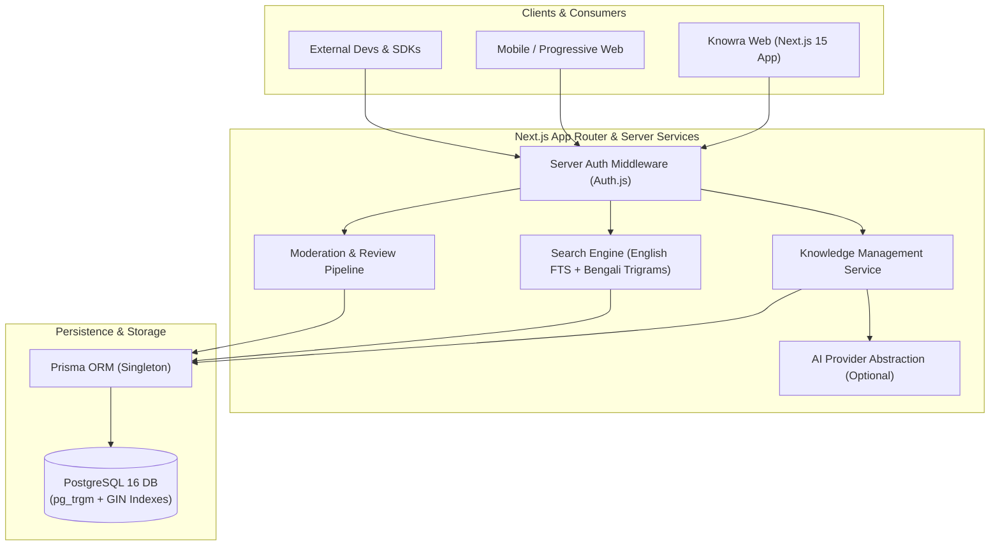
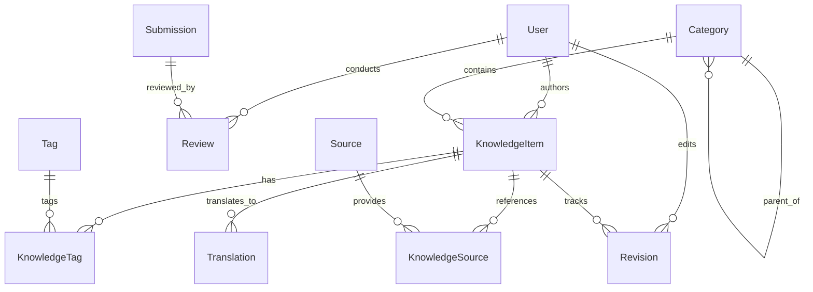
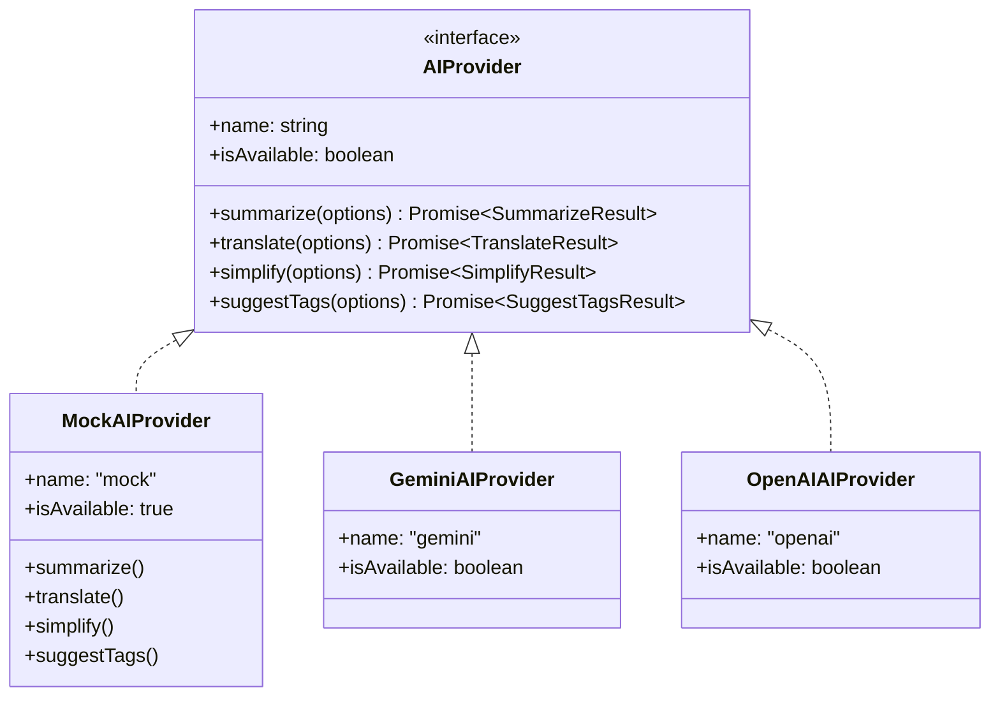

# Knowra Architecture & System Design

## 1. High-Level Architecture

Knowra is organized into three primary product modules running on a unified Next.js App Router and PostgreSQL backend:



---

## 2. Module Breakdown

### Module A: Knowra Web
- **Discovery Platform:** Server Components render knowledge articles, categories, and language toggles.
- **Bilingual Interface:** Instant language switching between English (`en`) and Bengali (`bn`).
- **Reading Comfort:** Scholarly typography pairing Atkinson Hyperlegible and Crimson Pro, with Noto Sans Bengali.
- **Source Verification:** Margin citations and footnotes directly referencing verified sources.

### Module B: Knowra API (`/api/v1`)
- **Public Endpoints:** Read operations for knowledge items, categories, search, and sources.
- **Security:** Rate limited by IP; no private user records, moderation discussions, or draft items are exposed.
- **Standardized Response Envelope:**
  ```json
  {
    "success": true,
    "data": {},
    "meta": { "page": 1, "limit": 20, "total": 100 }
  }
  ```

### Module C: Knowra Community & Moderation
- **Submission Workflow:** Unauthenticated/registered users submit knowledge with proposed sources (`Submission` entity).
- **Admin Review:** Reviewers evaluate submissions, record decisions (`APPROVED`, `REJECTED`, `CHANGES_REQUESTED`), and write revision histories (`Revision` entity).
- **Server-Side Protection:** Admin routes and API mutations require verified `ADMIN` or `EDITOR` session tokens.

---

## 3. Database Entity Relationship Overview



---

## 4. Decoupled AI Provider Architecture



AI operations strictly obey Section 6.3:
1. AI output is clearly marked (`isAiGenerated: true`).
2. AI-generated translations default to `reviewStatus: DRAFT` requiring human approval.
3. No hallucinated citations: AI operations cannot create `Source` records automatically.
