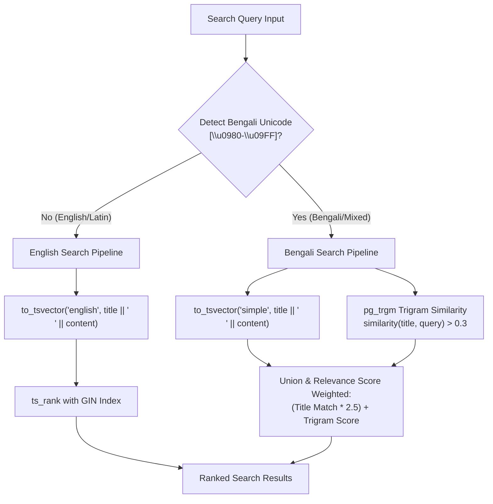

# Bengali (বাংলা) Full-Text Search Strategy in PostgreSQL

## 1. Problem Statement

Standard PostgreSQL full-text search configurations (such as `english`, `simple`, or `french`) rely on language-specific dictionaries, stopword lists, and Snowball stemmers.

When English search pipelines are applied to Bengali text (`to_tsvector('english', 'জ্ঞান প্ল্যাটফর্ম')`):
1. **Unicode Token Loss:** Words with complex vowel diacritics (কার/যুক্তবর্ণ) can be dropped or stripped incorrectly.
2. **Agglutination & Inflections:** Bengali is an inflected, morphologically rich language (e.g., `বিজ্ঞান`, `বিজ্ঞানে`, `বিজ্ঞানীরা`, `বৈজ্ঞানিক`). Standard Latin stemmers do not recognize these roots.
3. **No Native Bengali Dictionary:** PostgreSQL does not provide a native `bengali` stemming dictionary out-of-the-box.

---

## 2. Knowra's Multilingual Search Architecture

To ensure fast, highly accurate, and predictable search for both English and Bengali, Knowra adopts a **Language-Aware Router**:



---

## 3. Database Indexing Strategy

### 1. Simple Token Indexing for Bengali
```sql
-- Simple configuration preserves Bengali Unicode characters intact without corrupting stemmers:
CREATE INDEX idx_knowledge_content_simple 
ON knowledge_items 
USING gin(to_tsvector('simple', title || ' ' || summary || ' ' || content));
```

### 2. Trigram Indexing with `pg_trgm`
The `pg_trgm` extension breaks Bengali words into 3-character n-grams. This allows:
- Prefix matching (`সালোক...` -> `সালোকসংশ্লেষণ`)
- Suffix inflection matching (`বিজ্ঞান` -> `বিজ্ঞানীদের`)
- Typo-tolerance and conjunct matching

```sql
-- Enable trigram extension:
CREATE EXTENSION IF NOT EXISTS "pg_trgm";

-- Create GIN trigram indexes on title and summary:
CREATE INDEX idx_knowledge_title_trgm ON knowledge_items USING gin (title gin_trgm_ops);
CREATE INDEX idx_knowledge_summary_trgm ON knowledge_items USING gin (summary gin_trgm_ops);
```

---

## 4. Test Queries & Expected Match Matrix

During testing (Phase 2 & Phase 3), the following test suite validates Bengali search accuracy:

| Test Query | Target Knowledge Title | Expected Match Type | Strategy |
|---|---|---|---|
| `সালোকসংশ্লেষণ` | সালোকসংশ্লেষণ ও উদ্ভিদের খাদ্য তৈরি | Exact word match | `simple` tsvector |
| `সালোক` | সালোকসংশ্লেষণ প্রক্রিয়া | Prefix match | `pg_trgm` trigram index |
| `বিজ্ঞানীরা` | আধুনিক বিজ্ঞানের আবিষ্কার | Inflection root match | `pg_trgm` similarity |
| `সৌরজগৎ` | আমাদের সৌরজগতের গ্রহসমূহ | Exact compound word | `simple` tsvector |
| `solar সালোকসংশ্লেষণ` | (Mixed language) | Dual index query | Router detects mixed script |

---

## 5. Non-AI Fallback Verification
This search architecture runs purely inside PostgreSQL using SQL primitives and indexes. **Zero external AI API calls or vector embedding services are required for core search to function.**
